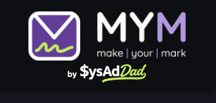
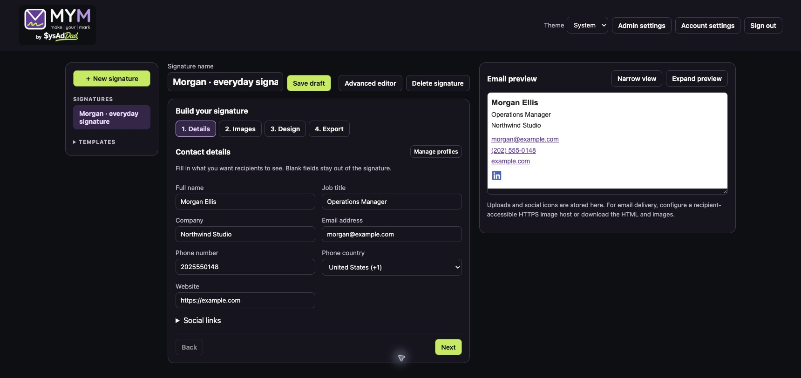
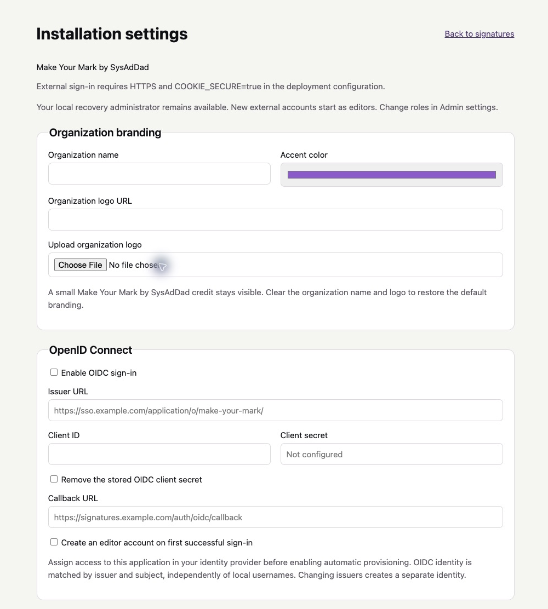

<p align="center">
  
</p>

# Make Your Mark

### Email signatures, without editing HTML by hand.

Make Your Mark is a self-hosted signature builder by **SysAdDad**. Fill in your details, choose a layout, and copy the result into your mail app. If you need more control, open the advanced editor to arrange text, images, links, and columns yourself.

It works for one person or a team. Members manage their own signatures and share templates. Administrators manage users, shared contact profiles, branding, and sign-in settings.



## What you can do

- Build a signature with the guided wizard or arrange blocks in the advanced editor.
- Add logos, portraits, social icons, email links, and properly formatted phone links.
- Choose fonts, text sizes, colors, spacing, and up to six columns per row.
- Add an optional contact QR code, capped at 100 px, that opens at full size when clicked.
- Save reusable templates and fixed versions of finished signatures.
- Use local accounts, OpenID Connect, or direct LDAP / Active Directory login.
- Replace the app name, logo, and accent color with your organization's branding. A small SysAdDad credit stays visible.

The output uses tables and inline styles for email. Mail apps still handle HTML differently, so test your finished signature in the clients you actually use. [The compatibility checklist](email-signature-compatibility-and-qa.md) tracks those checks.

## Run it with Docker

The image is `ghcr.io/sysaddad/mym-community:stable`, built for **amd64** and **arm64**.

The release image is public. No GitHub account or registry token is needed to pull it.

Choose either Docker or Compose below. They are alternative installations with separate data volumes.

### Docker run

```sh
docker volume create mym_data

docker run -d \
  --name mym \
  --restart unless-stopped \
  --publish 127.0.0.1:8080:8080 \
  --env COOKIE_SECURE=false \
  --volume mym_data:/data \
  ghcr.io/sysaddad/mym-community:stable

docker exec mym cat /data/setup-token
```

Open **http://localhost:8080/setup** on the Docker host. Enter the token and choose your own administrator username and password. The password must contain at least 12 characters. There are no default login credentials.

The `127.0.0.1` binding keeps this installation on the Docker host. If Docker runs on another machine, follow [LAN access and HTTPS](#lan-access-and-https) before opening it from your computer.

### Docker Compose

Create an empty folder and save this as `compose.yaml`. You don't need the source code or a Dockerfile for this option.

```yaml
name: make-your-mark-community

services:
  signature-manager:
    image: ghcr.io/sysaddad/mym-community:stable
    pull_policy: always
    restart: unless-stopped
    env_file:
      - path: .env
        required: false
    environment:
      DATA_DIR: /data
      COOKIE_SECURE: ${COOKIE_SECURE:-false}
      SIGNATURE_BIND_IP: ${SIGNATURE_BIND_IP:-127.0.0.1}
    ports:
      - "${SIGNATURE_BIND_IP:-127.0.0.1}:${SIGNATURE_BIND_PORT:-8080}:8080"
    volumes:
      - signature_data:/data
    healthcheck:
      test: ["CMD", "python", "-c", "import urllib.request; urllib.request.urlopen('http://127.0.0.1:8080/health')"]
      interval: 30s
      timeout: 5s
      retries: 3

volumes:
  signature_data:
```

Run these commands **from the folder containing `compose.yaml`**:

```sh
docker compose up -d
docker compose exec signature-manager cat /data/setup-token
```

Then open **http://localhost:8080/setup**. Compose 2.24 or later is required for the optional `.env` entry above. The same configuration is available in [compose.arcane.yaml](compose.arcane.yaml).

### Arcane

Paste [compose.arcane.yaml](compose.arcane.yaml) into a new project, then deploy it. In the container console, run:

```sh
cat /data/setup-token
```

Use the token on the setup page. Don't use the source-build [compose.yaml](compose.yaml) in an empty Arcane project: that file expects a Dockerfile and the application source beside it.

## LAN access and HTTPS

For Compose, create a `.env` file beside your Compose file. This example uses a private Docker-host address; **replace `192.168.1.50` with your host's actual LAN IP**:

```dotenv
SIGNATURE_BIND_IP=192.168.1.50
SIGNATURE_BIND_PORT=8080
COOKIE_SECURE=false
```

Apply the change:

```sh
docker compose up -d
```

You can now use `http://192.168.1.50:8080`. If that port is occupied, choose another host port. The container's internal port remains `8080`.

For `docker run`, use the LAN IP in `--publish` instead, for example `--publish 192.168.1.50:8080:8080`, and add `--env SIGNATURE_BIND_IP=192.168.1.50`. Changing these options requires recreating the container with the same data volume.

**Before enabling OIDC or LDAP**, put the app behind an HTTPS reverse proxy and set:

```dotenv
COOKIE_SECURE=true
```

Recreate the service, then sign in through its HTTPS hostname. Once secure cookies are enabled, HTTP IP-address login will no longer maintain a session. If your reverse proxy runs on another machine, forward it to the Docker host's private IP and chosen host port.

See [the admin guide](docs/administration.md) for SSO, LDAP, image hosting, backups, and troubleshooting.

## Build a signature

1. Start with **New signature** and fill in the details you want to include. Blank fields stay out of the result.
2. Add images and choose a layout, font, colors, and size. A contact QR code is optional.
3. Check the preview, including its narrow view.
4. Open **Export** and copy the formatted signature or download its HTML and images.

<details>
<summary>Organization branding and sign-in settings</summary>



</details>

**Save draft** keeps the editable signature. **Save version** stores a fixed copy inside the app; it doesn't install anything in your email account. **Export** gives you the content to install in your mail app.

For pictures to appear in emails sent outside your LAN, recipients must be able to reach their HTTPS image URLs. Keeping images on a private server is fine for editing, but doesn't make them accessible to outside recipients. [Image-hosting options](docs/administration.md#images-in-sent-email) are covered in the admin guide.

## Updates and your data

For the Compose installation above:

```sh
docker compose pull
docker compose up -d
docker compose ps
```

Back up `/data` before upgrading. It contains the database, images, and keys needed to read your saved settings. Keep the same Compose project name and volume. **Don't run `docker compose down --volumes` during an upgrade.**

The `stable` tag follows tested version tags, not every commit to `main`. You can pin the first release with `ghcr.io/sysaddad/mym-community:0.1.0`. To pin a version, use `ghcr.io/sysaddad/mym-community:sha-COMMIT_SHA` with the full commit SHA from a successful build. Docker-run installations need to recreate their container using the new image and the existing `mym_data` volume.

## Working on the app

To build the container from source:

```sh
git clone https://github.com/SysAdDad/MYM.git
cd MYM
docker compose up -d --build
docker compose exec signature-manager cat /data/setup-token
```

For local development, use Python 3.12:

```sh
python3.12 -m venv .venv
. .venv/bin/activate
pip install -r requirements.txt
python -m unittest discover -s tests -v
DATA_DIR=./data COOKIE_SECURE=false uvicorn app.main:app --host 127.0.0.1 --port 8080 --no-access-log
```

GitHub Actions runs the regression suite inside the container, checks Compose files, and tests setup and restart persistence using a disposable volume. Only version tags publish a release image. Development work is kept separate and is promoted here deliberately. See [the release process](docs/releases.md). Email-client rendering and real directory integrations need their own checks; passing unit tests isn't a substitute.

The [code review notes](docs/code-review.md) distinguish fixes, follow-up work, and checks that haven't been run. Screenshots above use fictional data in a disposable local installation.

## Credits and release status

Make Your Mark is a SysAdDad project. Social icons come from Font Awesome Free 6.7.2 and are licensed under [CC BY 4.0](https://creativecommons.org/licenses/by/4.0/); the individual brand marks belong to their owners.

Source code and documentation are available under the [MIT license](LICENSE). See [third-party notices](THIRD_PARTY_NOTICES.md) for icon and dependency attribution.
