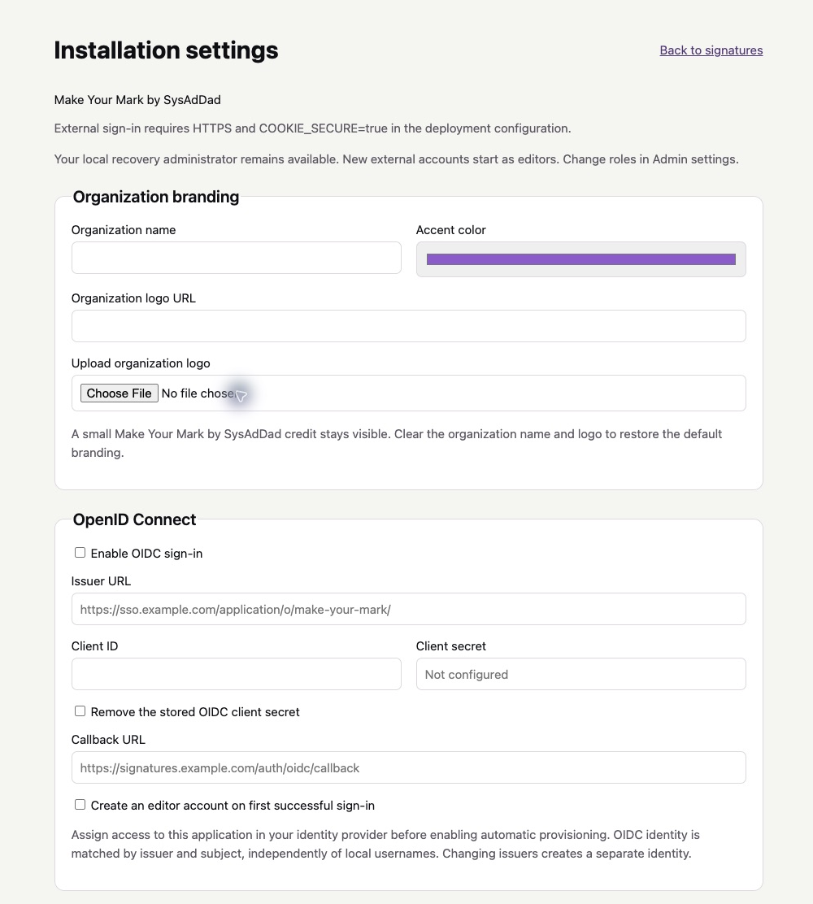

# Administration

[Back to the README](../README.md)

## Branding and accounts

Open **Admin settings → Branding and authentication settings** to change the app name, logo, and accent color. A small Make Your Mark by SysAdDad credit stays visible. Clear the organization name and logo to restore the default artwork. Signature colors are separate from the app's accent color.



Administrators can manage every user's signatures, templates, shared profiles, and user accounts. Members can access their own signatures and shared templates, create templates, and edit templates they created. Only administrators can delete signatures, templates, or profiles. Everyone can see the shared contact profiles; don't put confidential information in them.

**Account settings** shows the signed-in username, role, and sign-in method. Accounts with a local password can change their local credentials there. SSO-only and directory-only accounts manage their passwords through the identity provider or directory. Keep a local administrator for recovery.

## OpenID Connect

First configure your HTTPS reverse proxy and set `COOKIE_SECURE=true` in the container environment. Recreate the container after changing its environment. Use the HTTPS hostname throughout sign-in.

In the identity provider, create an application and provider for this installation. Then enter these values in Make Your Mark:

| Field | Example | What to check |
| --- | --- | --- |
| Issuer URL | `https://sso.example.com/application/o/make-your-mark/` | Must match discovery exactly, including a trailing slash when present. Don't append `.well-known/openid-configuration`. |
| Client ID | From your provider | Use the client registered for this installation. |
| Client secret | From your provider | Required for a confidential client. An empty field keeps an already saved secret. |
| Callback URL | `https://signatures.example.com/auth/oidc/callback` | Register this exact HTTPS URL with the provider. |

Enable **Create an editor account on first successful sign-in** if assigned users should receive accounts automatically. New accounts are non-admin; promote them explicitly in the user manager. Control who can use the application in your identity provider. Disabling automatic creation restricts access to identities you have provisioned manually.

OIDC users match by issuer and subject, not by username. A matching local username does not link accounts. Removing an SSO user blocks that identity from being automatically recreated.

Use **Test connections** and save. This checks discovery and published signing keys, not the client secret or a particular user's access. Finish with a real sign-in in a separate browser session before relying on SSO. Authlib handles state, nonce, token verification, and S256 PKCE.

### Authentik

Use a **Confidential** OAuth2/OpenID provider. Select an RSA certificate under **Signing Key**; leave **Encryption Key** unset unless you have separately verified encrypted-token support. Without a Signing Key, Authentik uses HS256 and doesn't publish the public signing keys this integration needs. See [Authentik's signing documentation](https://docs.goauthentik.io/add-secure-apps/providers/oauth2/).

Use that application's slug in the issuer URL. Make sure the application is assigned to the intended provider and that your user can access it.

### Troubleshooting SSO

- **`invalid_client`:** Check the client ID and saved secret against the same provider. Creating another provider doesn't update the app automatically.
- **Missing signing keys:** Select the provider's signing key and run the connection test again. After changing provider algorithms, restart the app to clear previously cached discovery metadata.
- **Identity not authorized:** Check first-login account creation, an explicitly assigned subject, whether the account is enabled, and the exact issuer.
- **Missing session / expired state:** Start from `/login` at the HTTPS hostname, in the same browser. Don't refresh or reuse a callback URL.
- **522, certificate errors, or a hostname that won't load:** Check DNS, the reverse proxy, and the HTTPS route before changing OAuth credentials.

For the Compose installation, run from its project folder:

```sh
docker compose logs --tail 100 signature-manager
```

For the Docker-run example:

```sh
docker logs --tail 100 mym
```

Logs include safe verification categories and exception class names, not provider error bodies. Redact secrets and `code` / `state` query parameters before sharing logs. The app omits access logs by default; apply similar query redaction at your proxy.

## LDAP and Active Directory

Direct directory login supports **LDAPS** and **StartTLS**. Plain LDAP and skipping certificate validation aren't supported.

Enter the directory hostname, port, service-account bind DN/password, search base, user filter, and stable identity attribute. Use a read-only service account. If your directory uses an internal CA, supply its PEM certificate so the app can validate the server's certificate and hostname.

| Directory | Typical port / security | Filter | Identity attribute |
| --- | --- | --- | --- |
| LDAP | 636 / LDAPS, or 389 / StartTLS | `(uid={username})` | `entryUUID` |
| Active Directory | 636 / LDAPS, or 389 / StartTLS | `(&(objectClass=user)(sAMAccountName={username}))` | `objectGUID` |

Restrict the search base or filter to the people allowed to use the app. The filter needs `{username}` exactly once. Login escapes the entered username, searches for exactly one matching entry, then verifies the user's password with a separate encrypted bind. User passwords aren't stored. LDAP referrals are disabled.

Automatic account creation produces non-admin accounts. Removing a user retains a blocked directory identity to prevent immediate recreation. Changing the directory host, port, search base, or identity attribute changes the identity namespace.

The connection test checks TLS, the service-account bind, and search-base availability. It doesn't establish that a user's password, search filter, and identity mapping all work. Test a real directory login separately.

## Images in sent email

Images uploaded to the app are stored in its data volume and served at generated `/media/` URLs. Those URLs are accessible without app login to anyone who can reach the server and has the URL. QR images contain the contact details encoded in them.

If recipients are outside your LAN, choose one of these approaches:

- Use images already hosted at reachable HTTPS URLs.
- Expose a dedicated HTTPS image origin and set `PUBLIC_BASE_URL` to it, with no path or query string.
- Download the HTML-and-images ZIP, host its images yourself, and replace the relative `./media/` paths with their HTTPS URLs before installing the signature.

A dedicated image proxy should allow GET/HEAD only for the generated image and social-icon paths under `/media/`. Keep editor, admin, login, and API routes behind your normal access policy. You don't need to expose the admin interface to serve signature images.

Contact QR codes are optional. They're removed from shared templates so a template doesn't accidentally retain its creator's contact card. Update contact details, regenerate the QR, then save the draft.

## Backups and recovery

Keep the **entire `/data` volume**, plus your Compose file and `.env`. The volume includes SQLite, uploaded images, `.session-secret`, and `.settings-key`. Losing the settings key makes encrypted provider secrets unreadable.

Stop the app before making a filesystem copy for a consistent backup. Protect backups as sensitive data, and test a restore into a separate installation. Keep the previous image revision for rollback. Don't run two app installations against the same SQLite volume.

Compose's default named volume is initialized for the container's UID/GID **10001**. If you use a bind mount instead, make that directory writable by UID/GID 10001. If your container management interface can't read `.env`, correct that file's ownership or restricted read permissions for its configured UID/GID; don't make secrets world-readable.

Settings saves detect stale revisions. Authentication-setting changes invalidate external sessions; branding-only changes don't. Local password changes invalidate other local sessions.

## Environment reference

Most installations only need the first four settings. [`.env.example`](../.env.example) lists the optional bootstrap and OIDC environment defaults.

| Setting | Purpose |
| --- | --- |
| `SIGNATURE_BIND_IP` | Compose's host listener address; use loopback or a private IPv4 address. |
| `SIGNATURE_BIND_PORT` | Host port; the container still uses 8080. |
| `COOKIE_SECURE` | `false` for initial HTTP testing; `true` behind HTTPS and required for external sign-in. |
| `PUBLIC_BASE_URL` | Optional public HTTPS origin for signature images. |
| `DATA_DIR` | Container data directory, normally `/data`. |
| `SESSION_SECRET` | Optional override; otherwise a persistent random key is generated in the volume. |

Blank secret inputs in Admin settings keep the saved value. Use the explicit removal checkbox to clear a secret. Saved provider secrets are encrypted and aren't returned by the settings API. Don't commit `.env`, data volumes, setup tokens, or database backups.
